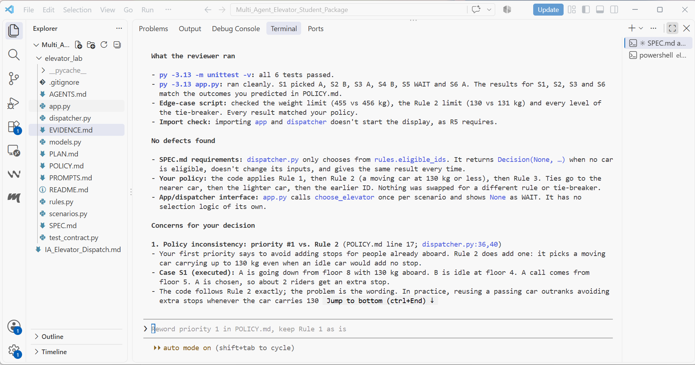

# My experiment results

Fill in this template with actual observations. Short bullets are sufficient.

Name / student ID: Milin Amornruttanadecha / 6480303

Tool, visible software version and model(s): Claude Code version 2.1.329

Route: automatic workers

## Agent outputs

| Role               | What it delivered                                                                                                                                                                                                                         | Brief excerpt or screenshot link                                                                       |
| ------------------ | ----------------------------------------------------------------------------------------------------------------------------------------------------------------------------------------------------------------------------------------- | ------------------------------------------------------------------------------------------------------ | --- | ------------------------ |
| Dispatcher builder | Wrote dispatcher.py directly in the workspace: calls eligible_ids, returns WAIT if none, then applies Rule 1 → Rule 2 → Rule 3 with the tie-breaker. The reason names the rule, distance and estimated riders.                            | screenshots/builder1.png, screenshots/builder2.png, screenshots/builder3.png, screenshots/builder4.png |
| Display builder    | Wrote app.py directly in the workspace: run_scenarios prints each scenario's name, both cars' state and the request, calls choose_elevator once, prints Selected: A/B/WAIT and the reason, and returns the decisions. No selection logic. | screenshots/builder1.png, screenshots/builder2.png, screenshots/builder3.png, screenshots/builder4.png |
| Reviewer           | No implementation defects (6 tests pass; edge cases 455/456 kg, 130/131 kg and tie-breaker all match policy). Raised 1 policy inconsistency (priority #1 vs Rule 2) and 1 policy tradeoff (Rule 1 ignores load/distance).                 |  "No implementation defects… raised two concerns about the policy itself" |     | screenshots/reviewer.png |

## Compare with my predictions

Ran py -3.13 app.py after adding S6. Predictions are from POLICY.md, committed before implementation.

| Scenario | Expected selection                      | Actual selection and reason                                                                                                     | Matches my policy? |
| -------- | --------------------------------------- | ------------------------------------------------------------------------------------------------------------------------------- | ------------------ |
| S1       | A (Rule 2: light passing car)           | Selected: A. "Rule 2 (light passing car): … A is moving down past it with 130 kg <= 130 kg … A is 3 floors from the caller"     | Yes                |
| S2       | B (Rule 3: A too heavy, B nearer)       | Selected: B. "Rule 3 (nearest car): no eligible moving car already stops at floor 5 or is light … B is 1 floor from the caller" | Yes                |
| S3       | A (Rule 1: stop already at 5)           | Selected: A. "Rule 1 (stop already scheduled): A is moving down and already stops at floor 5, so no stop is added"              | Yes                |
| S6       | A (Rule 2, even though B is at floor 5) | Selected: A. "Rule 2 (light passing car): … 65 kg <= 130 kg … A is 3 floors from the caller"                                    | Yes                |

- Supplied suite command and actual result: py -3.13 -m unittest -v → before implementation, 6 errors (NotImplementedError, expected); after implementation, "Ran 6 tests in 0.002s, OK".
- One review finding or concern I checked: Policy inconsistency between priority #1 and Rule 2 in choose_elevator. Evidence: S1 selects A, adding a stop for ~2 riders. I confirmed the code follows Rule 2 exactly, so the defect is in my wording, not the code. Decision: reword the priorities to match the rules. I also checked the reviewer's Rule 1 case (A at 455 kg already stopping at 5, B idle at 5 → A) and kept it as an accepted tradeoff: no stop is added for A's riders and B stays free, at the cost of a longer wait for the caller. The 455/456 kg flip comes from the shared capacity rule, not my policy.
- Change made, if needed: POLICY.md priorities reworded only (commit "Reword priorities to match Rules 1–3"). Rules, threshold, tie-breaker and predictions unchanged, so no code change and no rerun needed. The original wording is preserved in the earlier commit.
- Does my policy serve my stated priority? Yes. In S3, A already stops at floor 5, so the caller is served with no added stop and no second car, which is the best case. The cost shows in S6: B is idle at the caller's floor, yet the caller waits for A to come 3 floors because Rule 2 ranks reusing a light passing car above distance. A "nearest car first" policy would serve that caller faster but activate B every time.
- What did I have to coordinate between the agents? app.py only prints decision.reason, so the dispatcher builder had to put the rule name, distance and estimated riders inside the reason string; otherwise the display couldn't show why a car was chosen. Both builders used the Decision type from models.py, so the two files worked together without changes. For the review, I cleared the session so the reviewer judged the actual files rather than the builders' claims.
